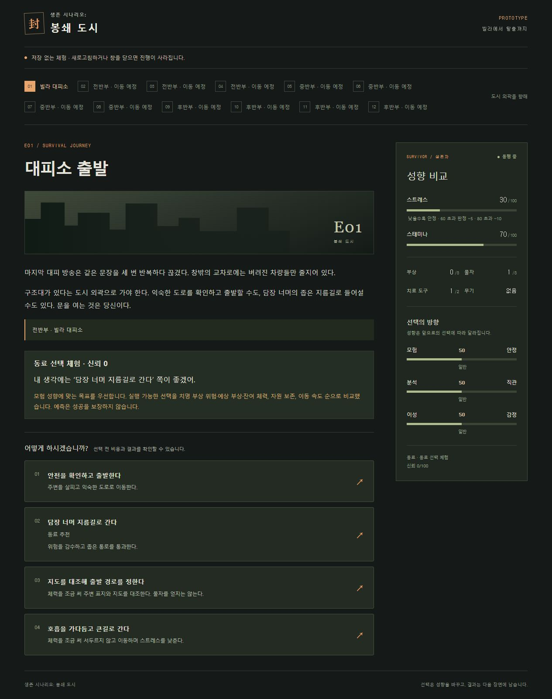

# 일반 동료 추천 — 생존 시나리오: 봉쇄 도시

## 이번 완료

2026-10-29 사용자가 세부 비교 제안에 “이 기준으로 구현”이라고 답했다. 일반 사건 E01/E02/E03/E05~E10과 탈출 E12에 실제 추천·보류를 연결했다. 정비 E04/E11과 극단 3+1은 기존 정책을 유지한다. 일반 장면은 본인4개 그대로이며, 동료 추천은 그중 최대1개에 표시한다. 신뢰0이어도 추천한다. 추천은 명령 수행이나 협력 보너스가 아니다.

## 승인된 비교

1. 사건의 `recommendation.axis`로 동료 성향을 읽는다. 정확히50은 중립이다. 다른 축이나 과거 집계로 중립을 덮어쓰지 않는다.
2. 실행 가능한 선택만 평가한다. 선택된 variant의 `traitDelta`가 선호 방향으로 향하는 행동들의 `goalId`를 선호 목표로 삼는다. 그 목표의 실행 가능한 방법 안에서 비교한다. 해당 방향이 불가능하면 남은 선택을 비교한다. 중립이면 모든 현재 후보를 비교한다.
3. 치명 부상 확률 최소 → 예상 부상 최소 → 예상 잔여 체력 최대 순이다. 예상값은 실제 미리보기의 성공률과 두 결과의 효과로 계산한다. 판정을 추첨하거나 미래 사건을 읽지 않는다. 회복/자원 상한도 실행과 동일하게 적용한다.
4. 생존 조건이 같은 후보는 예상 물자·치료 도구·무기를 각각 보존하는 쪽을 비교한다. 모든 자원이 같거나 더 좋고 하나라도 더 좋은 선택이 다른 선택을 앞선다. 물자와 치료 도구를 임의 환율로 합산하지 않는다. 서로 교환관계이면 보류한다.
5. 생존과 자원이 동등하면 명시된 `pace`의 fast > balanced > slow 순이다. 미상/동률이면 ID나 배열 순서로 임의 추천하지 않고 보류한다. pace는 실제 턴/시간 비용을 추가하지 않는다.

탈출은 risk<50이면 short, >50이면 detour를 선호하며, 50이면 실행 가능한 경로의 현재 생존·소모를 비교한다. 같은 목표ID를 쓰는 탈출에서도 경로 선호를 구분한다. 선호 경로가 잠겼으면 가능한 경로를 비교하며 모두 이동 불가일 때 기존 구조 요청을 추천한다. 현재 우회는 새 성공 판정이 없고 체력30, 지름길은15를 쓴다. 우회에 구현되지 않은 피해 감소를 부여하지 않는다. 위험이 같은 중립 상태에서는 지름길의 소모가 적다.

## 구조와 확장

- `src/engine/catalog/assessment.ts`: 실행과 공통 효과 적용을 공유하는 읽기 전용 평가.
- `src/engine/catalog/recommendation.ts`: 목표·생존·자원·속도 비교. 난수·신뢰·UI 상태에 의존하지 않는다.
- `runtime.ts`의 `catalogGeneralRecommendation`: 현재 네 선택과 잠금·variant를 연결한다.
- `src/content/texts/recommendation.ts`: 한국어 의견·이유·보류 문구.
- 앱은 기존 계약의 의견/추천 표시와 notices만 사용한다. 계약0.6.0 유지. UI 계산 복제 없음.

추가 사건은 JSON에 `recommendation: {"axis":"risk"}`처럼 축을 지정한다. 기본 게임 행동의 traitDelta/goalId를 사용하므로 사건ID별 분기를 추가하지 않는다. pace는 문구상 속도가 분명한 행동에만 명시하며, 알 수 없는 속도를0으로 보충하지 않는다. 기존 E04/E11 회복 예외 외 일반 사건은 축 누락 시 등록 거부한다. 탈출 축은 risk로 검증한다. 예시는 콘텐츠 작성 지침과 생성된 JSON Schema를 참조한다.

## 저장과 검증

신규 팩 `catalog-recommendation-1`, manifest.recommendationVersion=`survival-1`. 12장소/12사건/22그룹/88선택 항목/145문구 유지. 이전 reflection 팩은 `src/test/opening-catalog-v12.json`으로 고정했다. 메타데이터 없는 저장에는 일반 추천을 소급 추가하지 않는다. schema6 단독/runtime2 유지, schema7 동행/runtime `catalog-companion-recommendation-1`, schema8 계승/runtime `catalog-succession-4`. 저장 재생과 이전 런타임도 유지한다. 추천 조회는 상태·난수·저장을 바꾸지 않는다.

37파일448테스트, lint/build/content:check 통과. 성향49/50/51, 생존 순위, 자원 교환관계, 명시 속도/미상, 후보 순서 독립, 열 일반 장면의4개 유지, 탈출 조건, 정비/극단/구 저장, 실제 실행 및 저장 실패 동일 후보 재시도를 검증했다. 실제 브라우저에서 신뢰0 안정형=안전 출발, 모험형=지름길, 안전 출발 실행으로 risk50→58, E02 자원 교환관계 보류를 확인했다. 개발 무저장 체험만 사용했다.

## 다음

D08을 위한 실제 이전 선택 맥락 보존·동일 상황 재현·대표 선택의 약한 영향이 다음이다. 그 뒤 D03 자율 행동/명령/이탈·재회, D09 가변 분량과 두 회차 합계약15분 검증을 진행한다. 현재 추천은 과거 대표 선택의 약한 영향/동일 상황 재현을 아직 구현하지 않았다. 이별·재회의 신뢰 경계나 피해 규칙도 이번에 추가하지 않았다.
