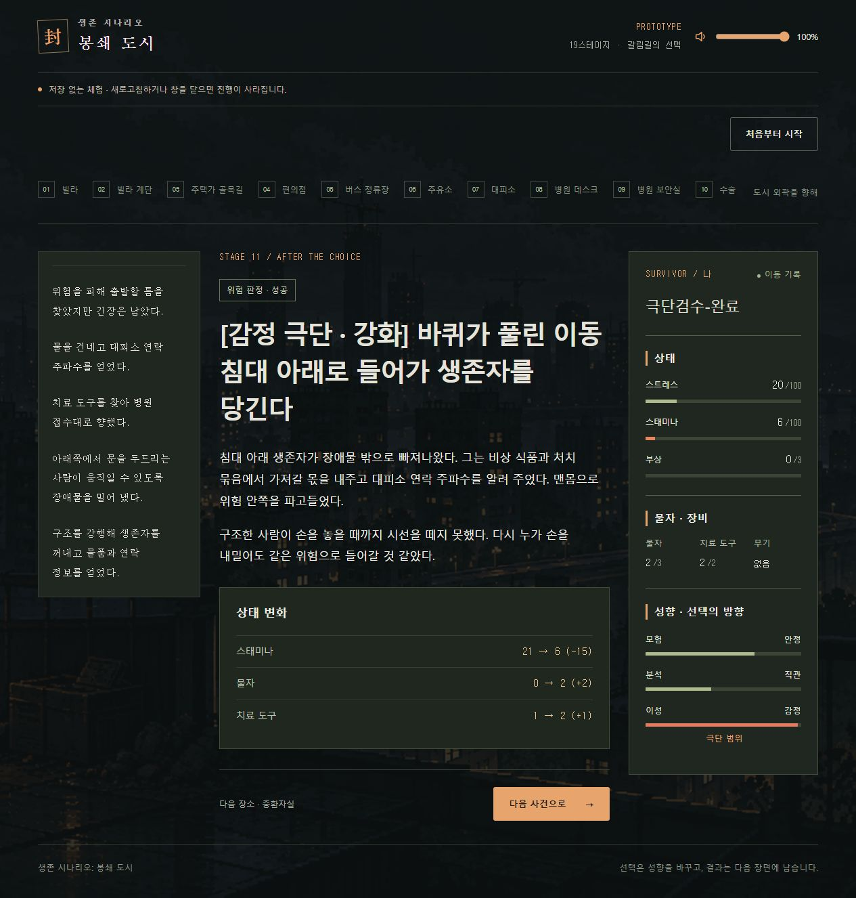
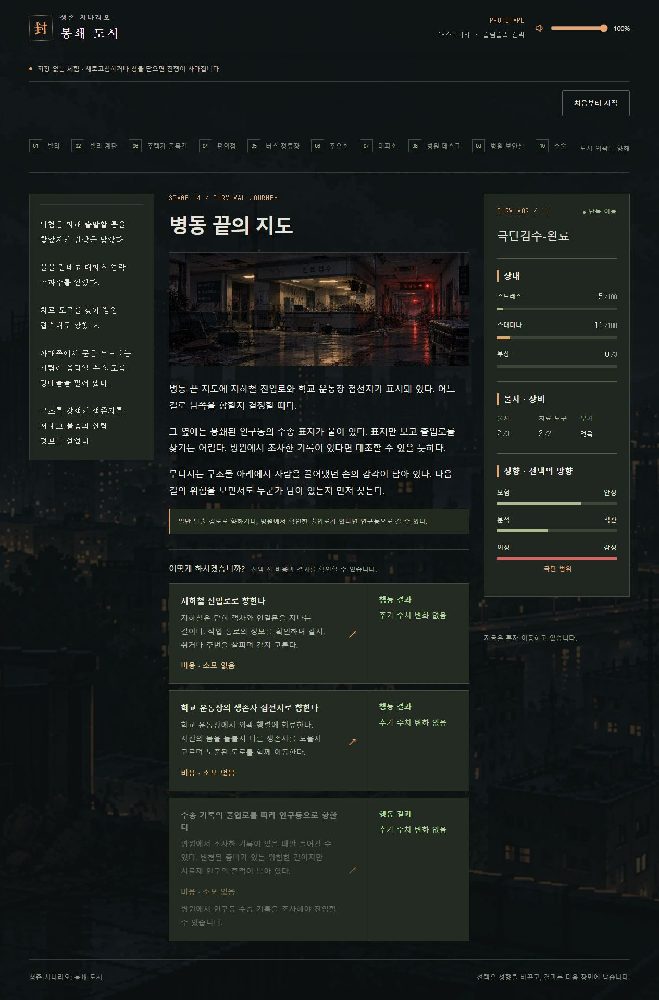

# 중반부 극단 발현과 강화 행동

2026-10-30. `codex/core-foundations`의 `a886dff`를 pull한 뒤 사용자 승인으로 적용했다. 새 기본 팩은 `catalog-middle-extremes-1`, `extremeExperienceVersion=middle-1`이다. UI 2차 개선과 신뢰 변화 2배(`trustScale=2`)를 유지한다. 사용자 요청 커밋 제목은 `ver-0.3.3 극단 시스템 보완`이며 원격 푸시는 수행하지 않았다.

## 승인된 목적

- 최초 극단 경험을 병원·백화점에서 제공한다. 일관된 방향을 택하면 11번, 중립 출발에서 같은 방향을 쌓으면 늦어도 13번에서 경험할 정상 경로를 둔다. 모든 사람을 자동으로 극단으로 만들지는 않는다.
- 극단은 이름만 다른 일반 행동이 아니다. 본인은 해당 목표를 포기할 수 없고, 강화 행동은 높은 실패 위험과 큰 성공 이익을 함께 가진다. 이전 문서의 “안정 극단은 위험 회피 보상만 제공”보다 이번 사용자 승인을 우선한다.
- 장면의 생각, 선택 이름·설명, 실제 성공·실패, 선택 기록과 다음 분기의 회상에서 편향과 대가가 이어져야 한다.

## 발현 배치와 누적

기존 19슬롯과 A/B 장소, 7·14번 분기는 유지한다. 11번 수술방·식품관과 13번의 옥상 통신실/병동 비상계단·백화점 비상계단/지하 하역장에 각각 여섯 극단 그룹을 둔다. 총 6장소, 36개 극단 장면이다. 무작위 A/B 때문에 마지막 중반 발현 기회가 사라지지 않는다. 14번의 확정 목적지 선택을 위험 판정으로 바꾸지 않는다.

초반 선택은 ±4를 기본으로 두고, 3·6번의 신중한 우회/위험한 통과에도 모험–안정 방향을 연결했다. 세탁소의 식품 회수는 추가적인 모험 누적에서 제외해 초반에 네 번의 모험 누적이 겹치지 않게 했다. 초반 각 축의 가장 유리한 누적 상한도 절댓값 12이므로 30/50/70 출발에서 15/85를 넘지 않는다. 정비와 분기의 성향 변화는 0을 유지한다.

중반의 실제 판단 행동은 기존 ±4를 ±8로 확대했다. 8·10·12번에는 관련 판단 방향이 없는 경우에만 장소에 맞는 선택을 보강하고, 9번의 구조/개인 사정과 위험 구분, 11번의 증거 대조/직감 통과도 연결했다. 극단 강화 행동 자체는 ±4이며 되돌리기 어려운 해당 장면 안에서 반대 방향을 고를 수 없다. 다음 일반 장소에서는 반대 선택을 통해 극단을 벗어날 수 있다. 경계값은 15/85를 유지한다.

여러 축이 동시에 극단이면 해당 장면의 우선순위 하나가 지배한다. 11번은 affect → risk → cognition, 13번은 cognition → risk → affect 순이다. 다른 축의 극단 때문에 모든 행동이 잠기지 않는다. 첫 안내는 기존처럼 회차 전체 1회다.

## 서로 다른 여섯 강제 목표

| 성향 | 강제 목표 | 성공 이익 | 공통 실패 대가 |
|---|---|---|---|
| 모험 | 무너지는 구역의 물품 강탈 | 물자 +2, 치료 도구 +1 | 부상 +2, 스트레스 +20 |
| 안정 | 뒤쪽 접근로를 직접 봉쇄 | 통과 경로 확보, 스태미나 +25, 스트레스 -15 | 동일 |
| 분석 | 불일치한 증거를 끝까지 확인 | 자료·통과 경로 확보, 스트레스 -10 | 동일 |
| 직관 | 닫히는 틈으로 즉시 돌파 | 스태미나 +40, 스트레스 -5 | 동일 |
| 이성 | 도움 요청과 위험을 격리 | 물자 +2, 치료 도구 +1, 스트레스 -20 | 동일 |
| 감정 | 무너지는 구역의 생존자 구조 | 도움 연락망, 물자 +2, 치료 도구 +1 | 동일 |

스태미나 보상은 행동 비용 적용 후의 효과다. 몸을 숨길 공간에서 쉬거나 긴 우회를 줄이는 결과로 서술했다. 비용 15/20과 현재 상한을 적용한 실제 순변화는 미리보기·결과에서 확인한다. 자원 상한에 닿았다면 전량 증가하지 않는다. 일반 그룹의 재고 상한·연구 기회 변형에서도 해당 성향 방향을 선택할 수 있도록, 물품 대신 짧은 통과나 독립적인 증거 대조 선택을 남겼다. 자료 확보는 해당 장소의 이동 기록이며 연구동 전용 기록·시료 fact를 대신하지 않는다.

각 극단은 무자원 강행(비용 스태미나15, 기본 성공률40), 물자1을 써 지지(스태미나20, 기본50), 무기를 지렛대로 활용(무기 필요, 스태미나20, 기본50)을 제공한다. 기존 성향·스트레스·신체 보정은 그대로 적용한다. 확정 성공·무위험 철수는 본인 극단 그룹에 두지 않는다. 물자0·치료 도구0·무기 없음·스태미나0에서도 강행할 방식은 남지만 생존을 보장하지 않는다. 기존 18번 이성 극단도 확정 방식 대신 실패 판정을 가지며 경로·물품 이익과 부상2를 연결했다.

동료가 있으면 기존 독립 동료 슬롯 정책으로 세 번째 방식을 바꾼다. 반대 성향 동료는 일반 그룹의 다른 목표를 제안할 수 있다. 본인의 안전한 철회와 혼동하지 않는다. 극단 동료 대안의 개별 신체 상태·피해와 신뢰 정책은 유지한다. 13번의 새 장면은 기존 최대3회의 유효 구조 판단 집계를 늘리지 않으며 성향·실제 선택 기록으로 계승된다.

## 문구·결과·후속 연결

선택에 `[성향명 극단 · 강화]`를 표시하고, 상황에는 각기 다른 편향을 썼다. 모험은 놓칠 물품, 안정은 봉쇄하지 않고는 떠나지 못하는 마음, 분석은 해소되지 않은 불일치, 직관은 생각보다 먼저 움직이는 몸, 이성은 타인의 사정보다 경계를 우선하는 판단, 감정은 먼저 나갈 길을 지워 버리는 구조 충동이다.

성공은 실제 물품·정보·이동 이익과 선택을 더 고집하게 되는 심리를, 실패는 목표 미달과 큰 신체 피해를 서술한다. 성공 fact는 다음 14번 분기의 회상으로 이어진다. 이미 쓴 물품을 현재도 소지했다고 단정하지 않는다. 고정 장소 기록에는 단순 “맨몸으로 들어갔다”가 아닌 실제 목표 성패 요약을 연결했다.

## 구현·이전 저장

`event.interventions[]`로 같은 사건의 서로 다른 극단 그룹별 동료 정책을 명시한다. UI에서 본문과 선택 카드가 같은 React key를 사용하던 충돌도 접두어로 구분해 장면 전환 중 누락을 방지했다. 기존 단일 `intervention`은 그대로 지원한다. 컴파일러는 새 버전 선언, 그룹 중복·축·극·반대 목표 참조, 동료 슬롯 교체 후 무자원 방식 유지를 검사한다. 앱은 실제 활성 그룹의 안내를 읽고, 기록 복원도 새 동료 선택 ID를 처리한다.

새 팩은 runtime15 / companion-extreme-1 / succession21이며 schema6/7/8을 유지한다. 직전 신뢰2배 팩을 `src/test/trust-scale-catalog-v1.json`에 보존했다. 구 저장은 저장에 담긴 원래 팩으로 재생한다. 행동 의미가 달라져 D08 호환 revision은 새 판본 하나만 지정했다.

신뢰2배를 pull한 기준판에서는 실제 ±10 신뢰가 의사결정 기록의 ±5 검사에 걸려 동료 회차 Legacy가 거부됐다. 기록 검사 범위를 현재 허용되는 ±10으로 맞춰 실제 다음 회차와 저장을 검증했다. 신뢰 계산·60/80 임계값·추천 손실 보호 자체는 변경하지 않았다.

## 검증과 남은 한계

- 신규 통합 검사: 두 경로 × 여섯 극 × 편향/중립 출발 24경로를 상태 주입·단계 건너뛰기 없이 진행해 11/13번 발현, 강제 목표, 위험 판정, 자원 경계, 저장 왕복을 확인한다. 실제 완료 회차에서 계승한 반대 성향 동료의 대안·개별 피해·기록 복원도 검사한다.
- 반복 실행: 24 seed × 2경로 × 6극 × 2출발형 = 576회. 목표 극의 첫 강제 장면 568회, 초반 발현 0회. 편향 출발 288회는 모두11번, 중립 출발의 성공 사례는11/13번이다. 나머지8회는 목표 장면 전 위험 실패로 조기 종료했다. 정상 완주했는데 누적 기회가 사라지는 경우는 최종 표본에서 없었다. 이는 일반 이용자의 발생률이 아니라 방향을 유지하는 QA 방침이다.
- 실제 UI: 저장 없는 설문부터 병원11번까지 정상 진행해 감정 극단의 구조 강행, 일반 철수 선택 부재, 낮은 성공률·부상2 미리보기, 성공과 물품 증가, 13번 강화 실패의 부상2, 14번 회상을 확인했다. 자동 검증의 사람 플레이 시간 환산은 하지 않았다.
- TypeScript·콘텐츠 형식·lint·제품 빌드를 확인한다. 전체 검사에서는 기준판에서도 실패하는 UI 문구·기록 마크업·탈출 미리보기 기대값 19건이 남는다. 기준판을 별도 폴더에서 실행해 이름별로 대조했으며 이번 작업으로 새로 실패한 검사 이름은 없다. 새 판본 기대값과 신뢰2배 기록 오류는 정리했다. 자세한 로컬 로그는 `.vitest/design-audit/`에 있다.

최종 통합 검사 59개(신규 극단 검사29개 포함) 통과. 전체742개 중723개 통과·기존19개 실패이며, 실패 이름은 모두 pull 기준판에서도 재현된 항목이다. TypeScript·lint·제품 빌드·콘텐츠 검사·git diff --check 통과, 기존의 큰 콘텐츠 청크 경고는 유지한다. 실제 UI의 중복 key 수정 후 장면 전환에서 신규 콘솔 오류·경고0건을 확인했다.

실제 사람의 난도·15분 목표와 일반 이용자의 극단 노출률은 후속 플레이테스트가 필요하다. 기존 보고서의 위임 UI·동일 상황 재현 등 다른 미달 항목은 이번 극단 개편의 완료 범위가 아니다.
