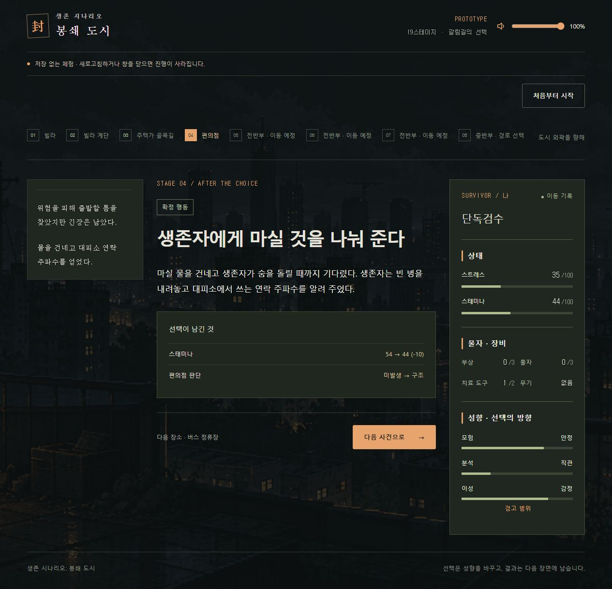

# 시나리오 문구·개연성 검수 — 2026-10-30

사용자 승인 범위는 문구 다듬기와 서사 개연성 검증이다. 선택 결과의 파라미터·조건·분기·동료 판단 시스템은 변경하지 않았다. 작업 브랜치는 `codex/narrative-polish`이며 `origin/codex/core-foundations`의 `a9a9e79`를 기준으로 했다.

## 참고 기준과 검토 범위

- [콘텐츠 작성 기준](content-authoring.md), [동료 대사 작성 가이드](dialogue-authoring.md)
- [19스테이지 진행](stage19-progression.md), [연구동 진행](research-route.md), [기존 서사 검수](story-revision-review.md)
- `AGENTS.md`, [협업 기준](collaboration.md), [기획안](references/product-plan-v1.2.md), [19스테이지 원안](references/location-storyline-19-stages-v1.md)

최신 구현과 사용자 확정 사항을 과거 기획보다 우선했다. 활성 팩의 54개 장소·54개 사건·1,260개 스크립트 정의를 대상으로 상황·선택·결과·조건부 반응과 기록의 연결을 대조했다. 전반부→병원/백화점→지하철/학교, 병원 단서→연구동의 다섯 경로를 확인했다. 과거 팩과 구 저장 복원용 fixture는 편집하지 않았다.

## 주요 수정

|구간·문제|수정과 후속 연결|
|---|---|
|빌라에서 떠나는 목적과 대피소 이후 남쪽 이동의 연결이 약함|마지막 연락에 남쪽 탈출로 안내를 명시하고, 대피소 지도는 먼저 떠난 사람들이 남긴 안내로 연결했다.|
|편의점에서 돕기 전부터 생존자가 물을 마신 듯한 서술|빈 병의 마지막 물방울을 기다리는 장면으로 수정했다. 나눔 선택·결과·동료 반응·기록을 마실 물을 건네는 행동에 맞췄다.|
|물자 0에서도 음식이 생기거나 배낭이 가벼워졌다고 단정하는 표현|기존 물 찾기 대안에서도 성립하도록 결과를 다듬었다. 음식이 남아 있는 장소에서는 배낭에 먹을 것이 없다는 점을 분명히 했다.|
|계단 방화문 아래로 발목을 보고 문 너머 상처를 직접 감는 동작|벌어진 문틈으로 발목을 확인하고, 붕대와 처치 방법을 건네 안쪽 사람이 감는 동작으로 연결했다.|
|동료 의견이 상태 조건 없이 발 떨림·가쁜 숨·물자 부족을 단정함|현재 장소에서 쉬고 싶거나 남길 몫을 고민하는 발화로 바꿨다. 표시 조건은 유지했다.|
|장소 이름만 바뀌는 반복적인 긴장 반응|주차장 경보, 기울어진 계단, 전자 매장 화면, 옥상 잡음, 행렬의 불안 등 해당 공간과 직전 행동에 맞게 다듬었다. 성향별 조건·우선순위는 유지했다.|
|동료 발화와 일반 서술의 구분이 불규칙함|말만 있는 의견에는 큰따옴표를 적용했다. 동작을 포함한 문장은 서술과 발화를 나눴다.|
|재회 때 확인되지 않은 화면 밖 의도와 감정을 설명함|재회한 현장에서 서로 알아보고 다시 나란히 서는 동작으로 바꿨다. 부재 중 구조 성과나 화해 완료를 만들지 않았다.|
|학교 운동장 합류 결과에 ‘계승 동료’라는 시스템 용어가 노출됨|외곽 행렬 속에 자리를 잡는 장면으로 수정했다. 나눔 결과와 이후 행렬에서의 회상도 대조했다.|
|물품을 버리는 것만으로 연결문 앞 장애물이 사라짐|걸린 배낭에서 짐을 버려 몸을 빼는 행동으로 원인과 결과를 연결했다.|
|연구 기록을 챙기는 시점에 아직 없는 시료를 전제함|시료를 확보했을 때 대조할 근거라는 표현으로 수정했다. 기록·시료 포기 결과가 다른 확보물을 부정하지 않도록 다듬었다.|
|최종 인계함 포기 결과에서 갑자기 구획이 붕괴함|실제로 제시된 위협인 변형 좀비가 가로막은 구획에 인계함을 남기는 것으로 수정했다.|
|헬기장 세 선택의 설명·동료 의견이 같음|직행·우회·구조 대기를 각 행동에 맞게 나눴다. 연구 성과는 연구 담당자에게 인계하는 장면으로 표현하고 투약이나 즉석 완치를 만들지 않았다.|
|터널 구조 대기에 기다린다는 문장이 중복됨|신호를 보낸 뒤 잡음 속에서 응답을 기다리는 한 장면으로 정리했다.|
|공통 사망 결과가 장소와 무관하게 ‘행렬에서 쓰러졌다’로 요약됨|공통 요약에서 장소 단정을 제거했다. 바뀐 결과 문장에는 대응 요약을 추가하고, 과거 문장을 조회하는 키도 유지했다.|

실제 변경은 스크립트 정의 455개와 선택 항목 47개다. 선택 항목 수는 동일 ID가 여러 조건 그룹에 정의된 경우를 각각 센 값이다. 모든 문장을 교체한 것은 아니다.

## 시스템 불변 확인

기준본과 수정본 JSON을 필드 단위로 비교했다.

- 사건에서는 `label`, `intention`만 편집했다. `behavior`, 비용·효과·확률·성향 변화·요구 자원·감염·관계·목적 구간·사실 기록은 동일하다.
- 스크립트는 `text`만 편집했다. ID·선택 ID·슬롯·조건·우선순위·가중치·재사용 정책과 배열 순서는 동일하다.
- 장소 정의·연결·슬롯·조사 기회 배정·추천·신뢰·개별 생존값·엔진·저장소·UI 동작 코드는 동일하다.
- 가이드가 요구하는 콘텐츠 판본 구분을 위해 revision만 `catalog-narrative-polish-1`로 올렸다. 기존 의미 호환 판본을 유지하면서 새 판본을 호환 목록에 추가했다. 관련 테스트의 판본 기대값 한 곳도 맞췄다. 런타임과 저장 형식은 변경하지 않았다.
- 기존 저장은 저장에 포함된 원래 팩으로 이어진다. 새 문구는 새 출발이나 명시적 다음 회차에 적용된다. 기록 요약은 표시 문구이며 저장된 사건·결과 원문을 고치지 않는다.

## 검증 결과

|검증|결과|
|---|---|
|콘텐츠 JSON Schema 생성·콘텐츠 검사|통과. 스키마의 의미상 변경 없음.|
|린트·TypeScript·제품 빌드|통과. 기존 대형 청크 경고는 남아 있음.|
|전체 기존 테스트|711개 중 706개 통과, 5개 실패. 아래 원본 대조 참조.|
|별도 수정 전후 자동 진행 비교|5경로 × 4시드 × 단독/동행, 총 40회. 19단계 진행·행동 결과·추천·경로·난수·물자·동료 생존값·관계·사실·결말 동일. 양쪽 판본의 저장 복원 통과.|
|수정 결과와 기록 연결 검사|통과. 기존 원문 조회도 유지. 별도 검사 총 6개 통과.|
|최종 문구 보완 뒤 재검사|콘텐츠/기록 검사·40회 비교·린트·빌드 통과.|
|실제 브라우저|별도 5182 포트의 무저장 단독/동행 체험. 빌라→A/B 여분 장소→편의점까지 확인. 단독 물자 0에서 물 찾기 행동, 결과, 기록 요약 대조. 두 탭 경고·오류 0건.|

첫 전체 실행에서는 병렬 실행 부하로 시간 초과도 발생했다. 워커 2개와 테스트 제한 60초로 재실행해 시간 초과를 해소했다. 프로젝트 테스트 설정 파일은 수정하지 않았다.

남은 실패는 원본 소스를 별도 디렉터리에 추출한 뒤 같은 테스트를 실행해 **동일한 5개 실패**를 확인했다. 문구 수정으로 새로 발생한 실패는 없다.

- `src/app/catalog-client.test.ts` 1개: 제거된 장소 안내 `notices`를 기대함.
- `src/app/stage19.test.ts` 2개: 경로 이동 뒤 장소 안내 `notices`를 기대함.
- `src/app/ui-history.test.ts` 2개: 현재 표시와 다른 `STAGE 04`, `남겨진 선택` 문자열을 기대함.

해당 동작과 테스트 기대치를 이번 문구 작업에 맞추려고 변경하지 않았다. 별도 검증은 저장된 상태와 콘텐츠를 비교한 자동 검사이며 사람이 40회 플레이했다는 뜻은 아니다. 브라우저에서 후반부 전체·모든 성향 조합을 재플레이한 것은 아니다.

## 화면 증거

물자 0 상태의 편의점 행동에서 스태미나 10을 소모하는 기존 계산을 유지하고, 선택·물 전달 결과·연락 주파수 획득 기록이 일치한다.

